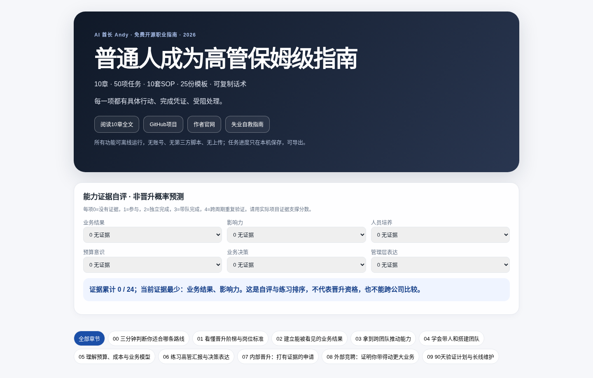
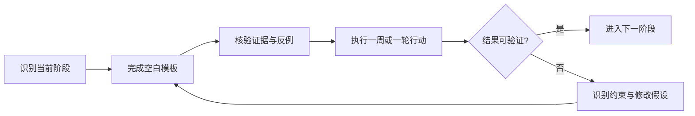

<div align="center">
# 普通人成为高管保姆级指南

**从业务骨干到经理、总监、经营负责人：把岗位能力做成可验证证据**

**100%免费 · 10章深度教程 · 50项可勾选任务 · 七阶段路线 · 三条赛道 · 10套SOP · 26份模板 · 20个FAQ · 离线互动网页**

[🚀 从这里开始](START_HERE.md) · [在线互动任务页](https://aipmandy.github.io/how-to-become-an-executive/) · [GitHub 仓库](https://github.com/AIPMAndy/how-to-become-an-executive) · [离线互动任务页](index.html) · [完整案例](CASES.md) · [AI提示词](AI_PROMPTS.md) · [问题解答](FAQ.md) · [可核验来源](SOURCES.md)

</div>

---

## 本版新增：事实与证据直接进入正文

**每个章节都附原始链接、样本/适用范围、观察结论、能执行的动作以及不可外推的边界**。另外新增可检查的来源登记表和真实证据审计，严禁把虚构案例当个人客户成功案例。

- [📚 证据资料库网页版（直接查看原文）](evidence/index.html) · [Markdown原始证据卡片](evidence/SOURCE_CARDS.md)
- [🧭 十章证据映射](evidence/CHAPTER_MAP.md)
- [🔬 对抗式事实审计及证据缺口](evidence/CLAIM_AUDIT.md)
- [📊 机器可读取的来源登记CSV](evidence/source_registry.csv)
- [✍️ 用于补充真正授权案例的采证模板](templates/research-provenance-template.md)


> **一句话解决的问题：** 看懂更高一级的工作责任，获得真正的授权与业绩，不再只靠“熬年头”和头衔。
>
> 适用于中国大陆常见职业语境。没有保证结果的承诺；数字案例均明确标“虚构示例”。证据增强及关键来源核验：**2026-10-12**。当地法律与招聘政策可能变化，个案以官方现行规则与专业意见为准。

**项目页面效果（由实际 HTML 渲染生成）**



## 先用真实证据理解“为什么业务骨干不一定能成为高管”

- **214家企业的实证研究**：业绩优秀员工更容易被晋升，但未必最适合管理岗位。见 [NBER原文](https://www.nber.org/papers/w24343)，在[第01章](guides/01-ladder.md)具体拆解。
- **一份真实高级管理岗JD**：Amazon中国公开 Sr. Manager 职位要求团队管理、招聘培养人才等；这与不带人的高级产品经理不同。见 [Amazon职位原文](https://amazon.jobs/en/jobs/10500669/sr-manager-product-management-roa-worldwide-global-selling)。
- **全球经理人的真实调查**：2025年经理人敬业度22%，相对2024年27%下降。见 [Gallup官方数据](https://www.gallup.com/workplace/349484/leadership.aspx)。此数据不预测中国经理表现。


## 只花3分钟，先选你的入口

| 你现在卡在 | 优先做 | 这周必须拿到 |
|---|---|---|
| 职业方向不清、是否带人 | [第00章](guides/00-start.md) | 管理/专家/项目三条路线对照 |
| 业绩不错但升不上去 | [第01章](guides/01-ladder.md) + [第07章](guides/07-internal.md) | 职级证据矩阵+主管校准纪要 |
| 没有下属、想拿管理机会 | [第03章](guides/03-influence.md) + [第04章](guides/04-people.md) | 授权协作试点+带教记录 |
| 已经带团队，想负责经营 | [第05章](guides/05-business.md) + [第08章](guides/08-external.md) | 业务模型+岗位权责核验 |
| 想长期建立领导力 | [第09章](guides/09-90days.md) | 90天实践证据计划 |

## 先执行这7天

| 天数 | 行动 |
|---|---|
| 第1天 | 对照3份JD，确定一个目标岗位与一条备选路线 |
| 第2天 | 按6维自评，逐条填写证据、来源与缺口 |
| 第3天 | 画出职级差距矩阵，列出2项优先练习 |
| 第4天 | 与主管校准授权边界、晋升标准和窗口 |
| 第5天 | 完成一份项目业绩证据卡 |
| 第6天 | 完成一次跨部门决策备忘录或带教练习 |
| 第7天 | 复盘：能力缺口/组织窗口/风险红线，决定90天路径 |

> **完成标准**：留下合法取得的证据，不是读完、收藏或打钩就算完成。能力评估不代表晋升概率；岗位称呼无法跨公司直接比较。

## 10章深度行动地图

| 章节 | 读完能够做什么 | 具体行动 |
|---|---|---|
| [00 三分钟判断你适合哪条路线](guides/00-start.md) | 高管没有全国统一职级，企业规模、管理幅度、预算权和业务责任差异很大。先判断目标角色，避免为了头衔牺牲职业资本。 | 本章5项任务+深入实操、反例、验收 |
| [01 看懂晋升阶梯与岗位标准](guides/01-ladder.md) | 管理岗并不自动等于高管。先用职责描述确认层级，再决定积累什么。 | 本章5项任务+深入实操、反例、验收 |
| [02 建立能被看见的业务结果](guides/02-results.md) | 高一级岗位优先关心可复核的结果、决策和影响范围。 | 本章5项任务+深入实操、反例、验收 |
| [03 拿到跨团队推动能力](guides/03-influence.md) | 越往上走，越需要在没有直接汇报关系的情况下推动协作。 | 本章5项任务+深入实操、反例、验收 |
| [04 学会带人和搭建团队](guides/04-people.md) | 人员管理需要对成长、公平、交付与合规负责。 | 本章5项任务+深入实操、反例、验收 |
| [05 理解预算、成本与业务模型](guides/05-business.md) | 高级管理岗位通常需要解释资源投入如何产生业务结果。 | 本章5项任务+深入实操、反例、验收 |
| [06 练习高管汇报与决策表达](guides/06-communication.md) | 重要沟通要让对方迅速做决定，信息清楚、证据完整。 | 本章5项任务+深入实操、反例、验收 |
| [07 内部晋升：打有证据的申请](guides/07-internal.md) | 晋升常是组织预算、岗位空缺与能力证据的交集。 | 本章5项任务+深入实操、反例、验收 |
| [08 外部竞聘：证明你带得动更大业务](guides/08-external.md) | 外部竞聘往往同时看过往结果、管理范围和能否复制到新环境。 | 本章5项任务+深入实操、反例、验收 |
| [09 90天验证计划与长线维护](guides/09-90days.md) | 高管成长需要周期复盘，不接受“30天保证晋升”。 | 本章5项任务+深入实操、反例、验收 |

## 别急着学管理，先弄清楚你想负责什么

上面十章回答「怎么做」。这一节回答「你想负责什么」。它整理自将归档的姊妹仓库 [how-to-become-executive](https://github.com/AIPMAndy/how-to-become-executive)，不另加 50 项之外的打卡任务。

普通员工完成任务；骨干解决复杂问题；项目 Owner 在有限授权下对一项结果负责；经理靠团队交付；业务或职能负责人要对经营指标、资源分配和风险做判断。更高级的岗位往往还涉及组织方向、人才、战略取舍和治理责任。**这是方便理解的成长顺序，不是任何企业统一的职级规定。**《公司法》第265条里的法定高级管理人员，不能从总监、VP 等业务头衔直接推定。全文、三条赛道和「不能直接照搬的地方」见[七阶段路线](guides/10-roadmap.md)。

| 阶段 | 首要转变 | 接着做 |
|---|---|---|
| 01 职业定位 | 从认 Title 到认责任和机会 | [第00章](guides/00-start.md) |
| 02 核心骨干 | 从完成任务到可核验的业务结果 | [第02章](guides/02-results.md) |
| 03 项目 Owner | 从帮忙执行到拿到有限授权 | [第03章](guides/03-influence.md) |
| 04 团队经理 | 从个人救火到团队能持续交付 | [第04章](guides/04-people.md) |
| 05 业务负责人 | 从项目指标到经营取舍 | [第05章](guides/05-business.md) |
| 06 高管候选 | 从资深经历到下一层岗位证据 | [第07章](guides/07-internal.md) · [第08章](guides/08-external.md) |
| 07 履新与治理 | 从拿到 Title 到真正负责任职 | [第09章](guides/09-90days.md) |

### 三条细分路线

[AI 产品与技术负责人](tracks/ai-product.md) · [产品 / 运营 / 销售负责人](tracks/product-operations.md) · [财务 / HR / 技术职能负责人](tracks/finance-hr-technology.md)。专家路线可以长期走，不必为了头衔强迫自己带团队。

## 10套执行SOP：跟着做，不需要先买课

| 保姆级SOP | |
|---|---|
| 1 | [SOP · 选定职业路径并设置止损条件](playbooks/00-career-path-decision.md) |
| 2 | [SOP · 用岗位描述做职级证据矩阵](playbooks/01-grade-gap-matrix.md) |
| 3 | [从业务骨干到经理：第一次晋升诊断](playbooks/01-promotion-diagnosis.md) |
| 4 | [把一个项目讲成管理层能决策的备忘录](playbooks/02-business-onepager.md) |
| 5 | [管理层外部竞聘全流程](playbooks/03-executive-interview.md) |
| 6 | [SOP · 无管理权的跨部门协作](playbooks/03-stakeholder-alignment.md) |
| 7 | [SOP · 完成首次授权与1:1反馈](playbooks/04-first-time-manager.md) |
| 8 | [SOP · 做出一页经营决策测算](playbooks/05-unit-economics.md) |
| 9 | [SOP · 准备内部晋升评审](playbooks/07-promotion-panel.md) |
| 10 | [SOP · 把90天计划变成每周可执行任务](playbooks/09-90day-execution.md) |

## 25份可复制空白模板

CSV文件建议用表格软件打开，**每份只含空白栏位**；不得把自己的身份证、工资流水、公司秘密、真实客户资料提交到公开仓库。

| 模板 | 模板 |
|---|---|
| [90-day-plan.csv](templates/90-day-plan.csv) | [authority-audit.csv](templates/authority-audit.csv) |
| [business-metrics.csv](templates/business-metrics.csv) | [business-scenarios.csv](templates/business-scenarios.csv) |
| [career-tracks.csv](templates/career-tracks.csv) | [coaching-log.csv](templates/coaching-log.csv) |
| [decision-rights.csv](templates/decision-rights.csv) | [feedback-record.csv](templates/feedback-record.csv) |
| [level-gap.csv](templates/level-gap.csv) | [promotion-1on1.md](templates/promotion-1on1.md) |
| [promotion-90days.md](templates/promotion-90days.md) | [promotion-evidence.csv](templates/promotion-evidence.csv) |
| [promotion-evidence.md](templates/promotion-evidence.md) | [promotion-interview.md](templates/promotion-interview.md) |
| [promotion-onepager.md](templates/promotion-onepager.md) | [promotion-pipeline.csv](templates/promotion-pipeline.csv) |
| [promotion-qna.csv](templates/promotion-qna.csv) | [promotion-readiness.csv](templates/promotion-readiness.csv) |
| [promotion-resume.md](templates/promotion-resume.md) | [promotion-review.md](templates/promotion-review.md) |
| [promotion-risk.md](templates/promotion-risk.md) | [promotion-stakeholders.md](templates/promotion-stakeholders.md) |
| [stakeholder-map.csv](templates/stakeholder-map.csv) | [succession-plan.csv](templates/succession-plan.csv) |
| [weekly-review.csv](templates/weekly-review.csv) |  |

## 两个典型读者的完整演练

- [两则包含输入、操作、算术、交付物和反例的虚构案例](CASES.md)。所有案例均明确标注虚构，**不得用于宣传“我已帮助某客户升职/拿到Offer”**。
- [20个常见疑问](FAQ.md)，包括岗位头衔、简历真实性、薪资口径、劳动合同与隐私。
- [5套AI辅助Prompt](AI_PROMPTS.md)，要求AI只做核对、模拟与改写，禁止臆造岗位经历。

## 免费互动网站：50项任务离线可运行

[直接打开 `index.html`](index.html)。页面包含任务搜索、按章节筛选、打卡与JSON进度导入导出，并提供六维管理证据自评。

- **隐私**：无需登录、API Key、第三方脚本；输入只在当前浏览器处理。浏览器进度由`localStorage`保存；浏览器清理数据可能丢失。
- **离线**：下载ZIP解压后，用浏览器双击`index.html`；所有任务交互无需联网。链接到GitHub和作者官网当然需要联网。
- **开发者**：`data/tasks.json`负责50个动作，`deepdives/`负责每章深入正文，运行`python3 build.py`重建首页与Markdown章节，**不会清空深度内容**；若要同时重建10个静态HTML阅读页，请先运行`python3 -m pip install -r requirements-dev.txt`。仓库已内置生成好的HTML，普通读者无需安装任何依赖。

```bash
python3 build.py
python3 -m unittest discover -s tests -v
```

## 复杂事项先看这里

- **职位与市场**：岗位信息与工资报告只代表对应样本，不代表个人保证收入；请检查时间、城市、职级、奖金性质。
- **劳动合同**：签字费返还、服务期、竞业限制与离职通知需要核对书面约定和现行法律；[最高法2025年司法解释（二）](https://www.court.gov.cn/zixun/xiangqing/472691.html)不能被简化为“竞业都无效”。
- **个人数据**：GitHub Issue、PR、AI聊天和公开讨论中**不提交**身份证、联系方式、合同/工资单原件、客户信息、公司业务秘密。
- **风险**：不支付“保录内推”费用，不制作虚假岗位、虚假绩效、虚假Offer。

## 流程图



## 自愿咨询：什么时候需要人帮你看？

项目从章节到模板均免费。如果你已经执行并明确卡在职级标准、晋升材料、岗位定位、简历证据、面试复盘、谈薪取舍等**个性化判断**，可以自愿向作者寻求职业咨询。

**作者：AI酋长Andy｜微信：AIPMAndy｜[官网](https://metaver.vip/)**。私聊时可备注「成为高管」，仅描述问题和已经尝试的步骤，不在公开Issue上传个人数据；价格、服务范围、课次、退款与交付在付款前确认。服务**不承诺保晋升、保录用、保涨薪**。详见 [BUSINESS.md](BUSINESS.md)。

## 审核、贡献和使用

- [对抗式审查与明确未验证边界](audit/ADVERSARIAL_REVIEW.md) · [官方与研究来源](SOURCES.md) · [并入的参考文献与外推边界](REFERENCES.md) · [发布SOP](LAUNCH.md) · [内容分发计划](CONTENT_GROWTH.md)。
- [如何贡献校正与新经验](CONTRIBUTING.md)：请附官方来源、适用范围、发布日期和验证日期。不要发布完整付费文章和未经许可的图片。
- **授权**：仓库代码按[MIT](LICENSE)，原创文字与模板按[CC BY 4.0](https://creativecommons.org/licenses/by/4.0/deed.zh-hans)署名共享；第三方资料保留其权利。分开说明见[内容授权](CONTENT_LICENSE.md)。
- **延伸阅读**：[Andy《失业了咋办？保姆级指南》](https://github.com/AIPMAndy/how-to-survive-unemployment)。

*提醒：本仓库不构成个性化法律、税务、薪酬或聘用承诺。*
