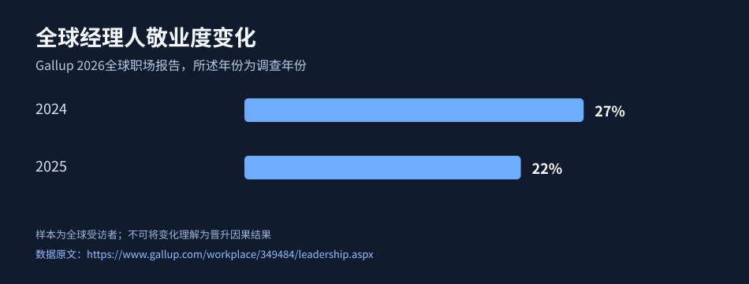

# 第09章 · 90天验证计划与长线维护

高管成长需要周期复盘，不接受“30天保证晋升”。

> 读法：每步有具体操作、完成凭证、卡住怎么办。敏感资料只留在本人私有目录。

## 1. 第1–7天：确定下一站

**具体操作：** 选定一个目标层级、三个能力差距、一个可承担的业务场景。

**完成凭证：** 一页90天目标清单。

**卡住怎么办：** 被日常事务打断时只保留最关键一项目标。

- [ ] 完成并留存合规凭证

## 2. 第8–30天：建立证据

**具体操作：** 完成至少三张项目证据卡并与主管沟通一次评价标准。

**完成凭证：** 三张证据卡及一次真实反馈。

**卡住怎么办：** 没项目就争取有明确边界的子任务。

- [ ] 完成并留存合规凭证

## 3. 第31–60天：扩大影响范围

**具体操作：** 推动至少一次跨团队协作和一次一页纸决策建议。

**完成凭证：** 会议行动记录及决策备忘录。

**卡住怎么办：** 无权推动时先争取负责人赞同。

- [ ] 完成并留存合规凭证

## 4. 第61–90天：申请校准

**具体操作：** 更新能力评分、组织复盘，决定继续积累、内部竞聘还是外部验证。

**完成凭证：** 90天复盘与下一季度计划。

**卡住怎么办：** 如果组织没有晋升机会，承认外部结构约束。

- [ ] 完成并留存合规凭证

## 5. 每季度复核一次

**具体操作：** 观察业务成果、授权范围、健康与家庭成本、岗位机会是否变化。

**完成凭证：** 季度复盘和三项下一步动作。

**卡住怎么办：** 长期无进展时改策略，不无限延长同一计划。

- [ ] 完成并留存合规凭证

## 深入实操：90天里验证下一职级能力

**第1—15天｜基线**：明确一个经上级认可的业务问题，写出现状指标、影响人群、你能做的决定和不能做的决定。与至少两位协作者校准问题，避免自行定义目标。

**第16—30天｜小试点**：提出两种方案、选一个可逆的小范围试点，明确资源、负责人和止损触发条件；保留事前假设。

**第31—60天｜证据积累**：每周登记领先指标、阻碍、跨团队协作记录和一次教练反馈，异常数据不隐藏。针对管理职责尝试培养一位协作者，记录其独立完成任务的证据。

**第61—75天｜复盘**：对照原始基线，拆开自己的贡献、团队贡献和外部环境因素；失败案例也应写出决策失误与修正。

**第76—90天｜申请或转向**：整理三张成果卡、一页经营建议，与主管做能力校准；若岗位窗口仍不存在，决定继续等待、扩大责任或探索外部机会。

**三条停止线**：活动违反公司保密合规；没有授权却要承担重大人事/预算风险；额外职责长期显著侵蚀健康或家庭底线。90天验证的是行动成果，不是保证晋升。

**本章验收**：每周复盘12次、基线与结果对照表、最终路线决策。

## 真实研究与招聘证据（原始出处，可直接核验）

这些资料解释为什么要执行本章任务；不能保证读者个人晋升或取得 Offer。

### 证据 E04 · Gallup《2026 State of Global Workplace》

**来源级别：** 机构调查。**样本/范围：** 全球劳动者调查；关注2024和2025两个年份经理人的敬业度。

**真实观察：** 全球经理人敬业度：2024年27%，2025年22%。

**外推限制：** 全球调查，不可推断中国具体企业的人事结果或因果关系。

**本章落地动作：** 设计经理负荷、团队反馈与风险记录；管理不是只要头衔。

[🔗 打开原始资料核查](https://www.gallup.com/workplace/349484/leadership.aspx) · [可直接打开的来源网页](../evidence/index.html)

### 证据 E03 · CCL 新任管理者常见挑战（2024年文章）

**来源级别：** 机构研究。**样本/范围：** CCL总结近300名参加其项目的新任领导者所遇挑战。

**真实观察：** 从独立贡献者转向带人，会遇到管理前同事、平衡工作、授权与沟通等典型问题。

**外推限制：** 培训项目参与者为便利样本；不代表中国全部经理。

**本章落地动作：** 挑两个管理困难做试点，每周留下结果和复盘。

[🔗 打开原始资料核查](https://www.ccl.org/articles/leading-effectively-articles/first-time-managers-must-conquer-these-challenges/) · [可直接打开的来源网页](../evidence/index.html)

### 数据图：全球管理者敬业度变化

图源：[Gallup官方2026报告](https://www.gallup.com/workplace/349484/leadership.aspx)，百分比为抽样报告数据，不能作为中国公司因果推断。

---

[返回总览](../README.md) · [离线互动任务页](../index.html)
